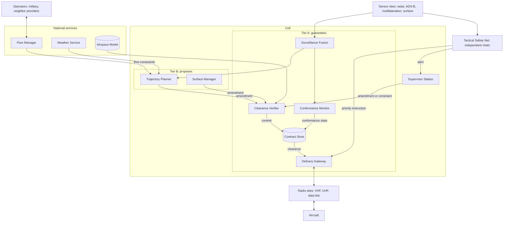
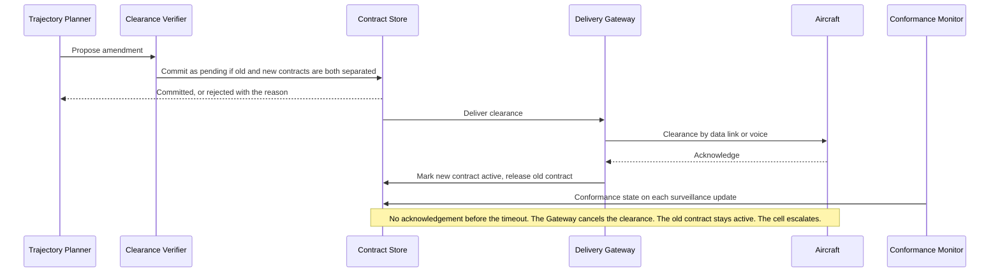

# Clearway: a design for automated air traffic control in the United States

| | |
|---|---|
| Status | Draft 0.1, 2026-11-15 |
| Scope | Architecture, safety approach, migration path. No cost estimate. |
| Standing | Independent design study. Not an FAA document. |
| Specification | [spec.md](spec.md): the exact definition of a tube, of separation, and of what a Verifier must do |
| Record | [record.md](record.md): the record of what a kernel decided, and what a party outside the operator can check in it |
| Machine | [vm.md](vm.md): the one machine that runs the kernel, and the one program that is the kernel |
| Prototype | [prototype.md](prototype.md): the kernel of section 6 for one en route cell, with simulation results. Changes that it forced are marked "(prototype)". [gap-analysis.md](gap-analysis.md) lists what separates it from this design. |

**Conventions.** A dagger (†) marks an initial design value. Simulation must confirm or replace it. Section 17 separates the sources checked for this draft from prior art cited from general knowledge.

## 1. Summary

About 11,000 certified controllers separate aircraft in U.S. airspace. Each controller works one sector and issues clearances by voice. The automation under them is about 138 separately built systems, and the FAA rates 51 of those as unsustainable. Capacity and resilience therefore scale with certified headcount per sector, and the system has been short of that headcount for years.

Clearway is one software stack that takes over clearance authority in stages. Its safety does not depend on any learned model being correct. AI does most of the work: it plans, predicts, listens, and speaks. A small verified kernel holds the guarantee: it decides whether a clearance may be issued.

The design rests on ten decisions.

1. **One contract per flight.** Each flight has one cleared 4D trajectory with stated tolerances. The set of all contracts is the single operational truth for surface, terminal, en route, and flow.
2. **A verified kernel is the only path to a clearance.** No clearance reaches an aircraft unless a deterministic, formally specified Verifier has shown that the resulting set of contracts is separated.
3. **AI proposes; the kernel disposes.** Learned models sit only where a wrong output costs efficiency. They are never on the approval path.
4. **Safe by state.** If all decision software stops, aircraft continue on contracts that are already separated for a known time. Safety does not depend on the software staying alive from second to second.
5. **One stack, many cells.** All airspace runs the same software and data model. Authority is held per cell, so a fault in one cell does not stop the country. Inside a cell, no one machine, release, or signer can issue a clearance alone.
6. **No new avionics for basic service.** The system speaks standard phraseology on existing VHF radios and understands readbacks. Data link gives better service where aircraft have it.
7. **Humans decide what needs judgment. Automation does what needs speed.** A human is never the sub-minute fallback for failed automation.
8. **Authority moves by evidence.** Each cell climbs five autonomy levels one at a time. Each step has pre-registered evidence gates and automatic demotion triggers.
9. **The same platform first replaces ERAM and STARS as a manual system.** That is the FAA's planned Common Automation Platform (CAP). Automation is then a mode of that platform, not a second replacement program.
10. **An open kernel and a checkable record.** The specification and the source of the kernel are public. Each cell keeps a tamper-evident record, and any party that holds it can replay the kernel and check every verdict.

The design end state keeps certified controllers as supervisors of automated airspace. It does not aim at a system with no humans.

## 2. Current state

| Topic | Fact | Source |
|---|---|---|
| Traffic | About 44,360 flights per day and 16.2 million per year. About 5,400 aircraft airborne at peak. | FAA |
| Facilities | 21 en route centers, 527 towers, about 150 terminal radar facilities. | FAA |
| Workforce | About 11,000 certified controllers and 4,000 trainees. In May 2026 the FAA cut its staffing target from 14,633 to 12,563. The controllers' union disputes the new target. | FAA, Bloomberg, Flying |
| Systems | 138 ATC systems. 51 unsustainable, 54 potentially unsustainable. | GAO-24-107001 |
| BNATCS phase 1 | 13 infrastructure programs: network, radios, voice switches, radars, surface surveillance, displays, weather. FAA estimate $10.6 billion. Target December 2028. | GAO-26-107992 |
| BNATCS phase 2 | A Common Automation Platform to replace ERAM and STARS, plus flow management. FAA estimate about $10.2 billion without facilities. No start date, no completion date, not funded. | GAO-26-107992 |
| Program control | As of May 2026: no lifecycle cost estimate and no integrated master schedule across 11,389 project schedules. | GAO-26-107992 |
| AI in operations | SMART, a flow-management advisory tool, entered use for the Washington-area airports in September 2026. FAA staff review each recommendation. The controllers' union says it was not involved. | NPR, GA News |
| Latest outage | Nationwide ground stop on 2026-11-13, about 4 h 20 min, after communication problems at several en route centers. The cause is preliminary. | FAA, Axios |
| Latest accident | Midair collision at Washington National, 2025-01-29, 67 killed. The NTSB cited FAA route design and oversight, and overreliance on visual separation. | NTSB |
| AI assurance | The FAA's 2024 roadmap says aviation has no accepted method for safety assurance of AI. EASA's proposed rule covers only offline learning with no contribution to critical failures. | FAA, EASA |
| Reference points | SESAR targets high automation for some flight phases by 2045. A NATS research agent passed a basic simulator exam; live shadow trials are planned. | SESAR, NATS |

Four conclusions follow.

- **The structure is the limit.** New radios and fiber do not change the fact that one human per sector issues voice clearances.
- **The architecture decision is open now.** Phase 1 buys the prerequisites: an IP network, radios, sensors. Phase 2 is not yet defined. If CAP is specified as ERAM and STARS functions on new hardware, the sector-and-voice structure is fixed for the service life of that platform.
- **No regulator accepts a learned model on a critical path.** A credible design must not need one there.
- **Past outages were common-mode failures.** One bad input or one data fault took down a primary system and its backup together (section 9.4). A unified stack makes this risk larger unless the design contains it.

## 3. Goals and non-goals

**Goals**

| ID | Goal |
|---|---|
| G1 | Collision risk is not higher than today's at any step, shown by evidence before the step. The long-run target is lower risk. |
| G2 | Capacity and continuity of service do not depend on the number of certified controllers per sector. |
| G3 | One platform serves surface, terminal, en route, and flow. Oceanic airspace joins later. |
| G4 | Migration has no flag day. Each cell changes alone, with a hot fallback. |
| G5 | An aircraft with a VHF radio and ADS-B Out gets basic service. |
| G6 | Every decision is recorded and reproducible from the record. |
| G7 | The government owns the architecture, the interfaces, the data, and the safety case. |
| G8 | The specification and the source of the kernel are public. A party outside the operator can check the record of what the kernel decided. |

**Non-goals**

- Reduced separation minima. The system applies today's standards. A change of minima needs its own safety case.
- Any change to pilot authority (14 CFR 91.3) or to airborne collision avoidance.
- A position on FAA governance or privatization.
- Military command and control, and drone traffic management below controlled airspace. The design gives both an interface.
- A cost estimate. The program owes one before commitment (section 13).
- An end state with no certified humans.

## 4. Design principles

**P1. Assign, then check.** The system does not try to predict where a free aircraft will go. It assigns a trajectory with tolerances and checks that the aircraft complies. Constraint reduces uncertainty more reliably than prediction does.

**P2. One owner per guarantee.** Each safety property has one component that owns it. Other components rely on it and do not re-establish it. The Planner does not own separation. The Verifier does not own efficiency.

**P3. A wrong AI output must be survivable by construction.** The architecture, not the model's accuracy, makes a model error harmless. This is the run-time assurance pattern of ASTM F3269: a complex function proposes, an assured function bounds it.

**P4. Closed contracts only.** Every contract ends in a safe end state: a landing, a published hold, or an accepted crossing into the next cell. The automation never leaves an aircraft on an open vector that needs a later instruction to stay safe.

**P5. Consistency before availability for commits.** A cell that cannot reach a quorum issues no new strategic clearance. Availability comes from coast time, island mode, and independent layers (section 9).

**P6. Identical replicas do not protect against bad inputs.** Protection needs input quarantine, staged rollout, two independent Verifier implementations, and a dissimilar backup.

**P7. Time-critical work belongs to automation. Judgment belongs to humans.** An escalation to a human states the decision, the deadline, and what the automation does if no decision arrives.

**P8. Evidence gates are set before the evidence is collected.** Staffing pressure and schedule pressure are not evidence.

## 5. Terms

| Term | Meaning |
|---|---|
| Flight | One aircraft operation that receives ATC service. One globally unique flight identifier names it. |
| Trajectory | A 4D path: positions, altitudes, and times, with speed and time constraints. |
| Envelope | The volume around a trajectory, at each time, inside which a conforming aircraft stays. It covers navigation tolerance, altitude tolerance, and along-track uncertainty. |
| Conformance envelope | The envelope less a detection buffer. The Verifier protects the envelope. The Monitor checks the conformance envelope, so an aircraft that strays is reported while it is still inside the envelope. (prototype) |
| Re-anchor | An update of the times and the envelope of a contract from the latest track. The path does not change, and no clearance is sent. (prototype) |
| Contract | The trajectory a flight is cleared to fly, with its envelope. A contract is *pending* after the Verifier approves it and *active* after the aircraft acknowledges it. |
| Amendment | A proposed change to a contract. |
| Clearance | The message that delivers an amendment to an aircraft. |
| Authority | The one actor, the automation or a named human, that may issue clearances to a flight. |
| Cell | A volume of airspace with one Contract Store and one Verifier. |
| Kernel | The Contract Store, the Clearance Verifier, and the Conformance Monitor of a cell. |
| ODD | Operational design domain. The conditions under which the automation may hold authority over a flight. |
| Level | The autonomy level of a cell, L0 to L4 (section 8). |
| Verified window | The time span over which the Verifier has shown a contract to be separated from all other contracts. |
| Coast time | The time for which all contracts in a cell stay separated if no further clearance is delivered. It equals the shortest verified window in the cell. |
| Intruder | An aircraft with no contract, or an aircraft outside its envelope. The system predicts an intruder from its state only, with a wide envelope. |
| Controller | A certified human who holds authority for all flights in a sector (legacy operations, L1, L2). |
| Supervisor | A certified human who supervises automated airspace (L3, L4). |
| Hold state | A degraded state of a cell. The cell issues no new strategic clearance, and the Flow Manager stops inflow (section 9.3). |

## 6. Architecture

### 6.1 Overview

Sensor sites and radio sites form the edge plane. The Recorder and Digital Twin read every flow in the diagram and are not drawn.

The stack has three assurance tiers.

| Tier | Contents | Property | Change cadence |
|---|---|---|---|
| A | Surveillance Fusion, Contract Store, Clearance Verifier, Conformance Monitor, Tactical Safety Net, acknowledgement logic of the Delivery Gateway, Airspace Model data | Separation depends on it. Deterministic. Formally specified. No learned model. | Slow. Each change carries a safety-case update. |
| B | Trajectory Planner, Fallback Resolver, Surface Manager, Flow Manager, Weather Service, all learned models, speech recognition and synthesis | Tier A checks its output. A failure costs efficiency or availability. | Frequent, through shadow runs. |
| C | Recorder, Digital Twin, analytics, external information services | Not in the control loop. | Continuous. |

**Rule.** No Tier A component depends on a lower tier for correctness. It may depend on a lower tier for liveness and efficiency.

### 6.2 Kernel invariants and assumptions

The kernel of a cell maintains five invariants.

| ID | Invariant |
|---|---|
| I1 | **Single authority.** Each flight in the cell has exactly one authority at each time. |
| I2 | **Verified separation.** Each contract has a verified window. Inside the windows, the envelopes of every two contracts, active or pending, meet the applicable separation standard, and each envelope is clear of terrain, obstacles, and active restricted airspace. The Verifier extends each window toward the verification horizon (20 min† en route) as time advances. |
| I3 | **Closed contracts.** Each active contract ends in a landing on a reserved runway, a published hold at a reserved level, or a crossing that the next cell has accepted. |
| I4 | **Pending protection.** While an amendment is pending, I2 holds for the old contract and for the new contract. |
| I5 | **Serialized commit.** The cell applies all contract changes in one total order. The Verifier evaluates each amendment against the state at its position in that order. |

A *predicted conflict* is a pair of contracts whose windows the Verifier cannot extend. It first appears near the verification horizon. A conflict can also appear closer in, when a flight becomes an intruder or when an envelope widens. The escalation ladder (section 6.5) handles both cases.

I4 covers the interval in which the system does not know which trajectory the crew will fly. I5 prevents two amendments that are each safe alone from being unsafe together.

Five rules make the invariants workable. The prototype showed that each one is needed.

| Rule | Statement | Without it |
|---|---|---|
| Re-anchoring | Once per minute† the kernel re-anchors each conforming contract on its track. The kernel accepts a re-anchor only if no verified window gets shorter. | Along-track uncertainty grows without limit, and every envelope becomes too wide to use. |
| Commit horizon | An amendment must be free of conflict for 15 min†. Windows are then extended toward the 20-minute horizon. | Envelopes that are wide at 20 minutes reject most amendments. |
| Inherited envelope | A new contract takes the envelope of the contract it replaces. | The new envelope is smaller than the real uncertainty: the aircraft may be anywhere inside the old envelope when the amendment is committed. |
| Vertical timing | Each vertical segment is in effect earlier and later than its nominal times, by the along-track uncertainty divided by the ground speed. | An aircraft that is ahead of its contract starts a climb before the kernel protects it. |
| Divergence point | An amendment leaves the current contract at a stated point on the current path, far enough ahead to deliver the clearance and outside any vertical transition. Up to that point the old and the new contract are the same. | The kernel cannot say where the aircraft is while the clearance is in transit. |

The invariants are guarantees only if five assumptions hold. Each assumption has an owner and a run-time monitor.

| ID | Assumption | Owner | Run-time monitor |
|---|---|---|---|
| A1 | The true position of each track lies inside its integrity bound. | Surveillance Fusion | Cross-check between independent sensor types. |
| A2 | A conforming aircraft stays inside its envelope. | Envelope parameters in the Airspace Model | The Conformance Monitor measures the rate of envelope exits and the margins that aircraft use. If either exceeds its budget, the cell widens envelopes automatically. |
| A3 | The intended aircraft, and only that aircraft, received an acknowledged clearance. | Delivery Gateway | The Conformance Monitor checks that the right aircraft manoeuvres and no other aircraft does. |
| A4 | The Airspace Model is correct: terrain, obstacles, procedures, airspace status. | Airspace Model release process | Static verification at each release. Two-person entry for dynamic changes. |
| A5 | Site clocks agree within a stated bound. | Platform | Independent time sources. A site that exceeds the bound leaves the quorum. |

A widened envelope reduces capacity. It never reduces separation. This is the general failure direction of the design: degraded knowledge costs throughput.

### 6.3 Component contracts

**Surveillance Fusion (Tier A)**

- *Role.* Fusion produces one track per aircraft from ADS-B, secondary radar, primary radar, multilateration, and surface sensors. Fusion is one national function, so a track keeps its identity across cells.
- *Requires.* At least two independent sensor types cover each volume in the ODD. ADS-B depends on satellite navigation. Radar and multilateration do not.
- *Guarantees.* Each track carries an integrity bound. If Fusion cannot support the bound, it flags the track as degraded within 5 s†. Fusion rejects an ADS-B position that an independent source contradicts.
- *On failure.* When a volume loses independent coverage, Fusion widens the bounds. The Verifier then requires more spacing, and the cell publishes lower capacity.

**Contract Store (Tier A)**

- *Role.* The Store holds every contract, its state, and the authority for each flight.
- *Guarantees.* The Store applies changes in one total order. A committed change survives the loss of any one site. Replay of the same log produces the same state.
- *On failure.* Without a quorum the Store accepts no change. Active contracts stay in force. The cell enters hold state.

**Clearance Verifier (Tier A)**

- *Role.* The Verifier is the only component that can commit an amendment.
- *Requires.* The Store supplies the committed contracts. The Airspace Model supplies the separation standard, the envelope parameters, and the active constraints. Fusion supplies integrity bounds.
- *Guarantees.* The Verifier commits an amendment only if I2, I3, and I4 hold after the commit. The check is conservative: the Verifier may reject a safe amendment, and it does not approve an unsafe one.
- *Does not guarantee.* The Verifier does not choose trajectories, does not optimize, and does not judge fairness.
- *Implementation.* Two teams build two implementations from one formal specification. Each kernel replica runs both and votes to commit only if both approve (section 9.5). The two should differ in kind: in the prototype one is exact and one is a conservative bound, and the second found two defects in the first.
- *Disagreement.* The specification states a tolerance in distance and in time. If one implementation approves and the other rejects, the approving one runs again with the standard tightened by the tolerance. If it then rejects, the disagreement is marginal: the Verifier rejects the amendment and raises no alarm. If it still approves, one implementation is wrong: the Verifier rejects the amendment and raises an alarm. (prototype)
- *On failure.* If alarms persist, the cell enters hold state.

**Conformance Monitor (Tier A)**

- *Role.* The Monitor compares each track with the envelope of its contract.
- *Guarantees.* Within two surveillance updates after an aircraft leaves its conformance envelope, the Monitor marks the flight as an intruder. The detection buffer is sized so that the aircraft is still inside its envelope at that moment. Where an aircraft broadcasts its selected altitude or heading (ADS-B version 2 target state), the Monitor compares the selection with the contract before the aircraft moves.
- *Effect.* The Verifier treats an intruder with a wide state-based envelope. Amendments for nearby flights follow from that. The Planner offers the intruder a new contract from its extrapolated state. The flight counts as a contract flight again only when the Monitor sees it inside the new conformance envelope. (prototype)

**Tactical Safety Net (Tier A, independent)**

- *Role.* The Safety Net is the last ground-based layer.
- *Requires.* Raw sensor data through its own tracker. The Safety Net does not read the Contract Store. It uses broadcast selected altitude to recognize a level-off.
- *Guarantees.* If two aircraft are predicted to lose separation within 120 s†, or an aircraft is predicted to reach terrain, an obstacle, or active restricted airspace, the Safety Net raises an alert. At L3 and L4 it also sends a tactical instruction through the Gateway with priority.
- *Independence.* A different team builds it. It shares no code, no hardware, and no network path with the kernel.
- *On failure.* If a cell loses its Safety Net, the Flow Manager stops inflow and the cell widens envelopes until the Safety Net returns.
- *Known limit.* A net that predicts from state alone does not know that an aircraft is about to turn. In the prototype it issued instructions to aircraft that were in no danger, and one such instruction caused a loss of separation. The net needs one of three things: intent from the aircraft itself (for example the next waypoint by data link), a Verifier rule that rejects a contract which the net would misread, or an instruction look-ahead that is shorter than its alert look-ahead. This is open (section 15). (prototype)

**Delivery Gateway (acknowledgement logic Tier A, speech models Tier B)**

- *Role.* The Gateway delivers each clearance by data link, or by synthetic voice on the assigned frequency, and captures the acknowledgement.
- *Requires.* Each clearance carries a quorum certificate: the signatures of the kernel replicas that committed it (section 9.5). The Gateway delivers no clearance without one.
- *Guarantees.* The Gateway reports each clearance as acknowledged, refused, or failed. It reports *acknowledged* only when a data link reply matches the message, or when a readback matches the callsign and every safety-relevant element of the clearance. If no acknowledgement arrives within the timeout (10 s† voice, 60 s† data link), the Gateway repeats the clearance once, then reports *failed*.
- *Voice output.* The Gateway composes speech from the structured clearance with the fixed phraseology grammar of FAA Order JO 7110.65. No generative model composes a clearance.
- *Voice input.* A readback that the recognizer cannot match counts as no readback. The residual hazard is a false match. The Conformance Monitor is the barrier for it (A3).
- *Emergencies.* If the Gateway hears MAYDAY or PAN-PAN, or Fusion reports an emergency transponder code, the Gateway alerts the Supervisor immediately and opens the audio to them.
- *Access to a human.* The synthetic voice identifies itself as automated. A pilot who asks for a controller reaches the Supervisor.

**Trajectory Planner (Tier B)**

- *Role.* The Planner proposes amendments that resolve predicted conflicts, meet flow constraints, sequence arrivals, avoid weather, and grant requests from pilots and operators.
- *Method.* Deterministic search and optimization, guided by learned models that predict trajectories and rank candidates.
- *Guarantees.* Liveness only. For each predicted conflict the Planner obtains a committed resolution at least 10 min† before the first loss of separation, or it escalates (section 6.5).
- *Stability.* The Planner amends a contract only for safety or for a benefit above a threshold. Crews must not receive a stream of small changes.
- *On failure.* Active contracts stay valid. The Fallback Resolver, a simple deterministic generator of standard manoeuvres, takes over conflict resolution. Its output still passes the Verifier.

**Flow Manager (Tier B, national)**

- *Role.* The Flow Manager balances demand and capacity hours ahead with departure times, routes, and metering times. It replaces the functions of today's flow and metering systems.
- *Guarantees.* Planned demand for each cell and each runway stays at or below the capacity that the cell publishes. When a cell lowers its capacity, the Flow Manager absorbs the difference on the ground first.
- *Purpose in the safety design.* The Flow Manager is not a separation barrier. It keeps the Planner's problem solvable.
- *Policy.* Rules for who takes delay are published FAA policy. The Flow Manager holds them as explicit, versioned constraints and objectives. Operators submit preferences, and every allocation is auditable.

**Surface Manager (Tier B)**

- *Role.* The Surface Manager plans gate-to-runway movement. Taxi routes are contracts with hold points. A runway is a resource with exclusive reservations that include wake spacing.
- *Requires.* Surface surveillance with an integrity bound. At an airport without it, tower controllers keep authority on the surface and the runway.

**Airspace Model (Tier A data, national)**

- *Role.* One versioned model holds airspace, routes, procedures, terrain, obstacles, separation standards, envelope parameters, letters of agreement, and dynamic status: restricted airspace, flight restrictions, runway configuration.
- *Guarantees.* Each release passes static verification. For every pair of published routes and procedures, the model shows procedural separation, or it records a dependency that the Verifier enforces. The helicopter route and the runway 33 approach at Washington National, which the NTSB found could be as little as 75 ft apart vertically, is the class of defect that this check finds before publication.
- *Replaces.* The per-facility adaptation data of ERAM and STARS, and the local knowledge now held in facility procedures.

**Supervisor Station**

- *Role.* The Station shows the state of a cell, the authority for each flight, and a queue of escalations. A Supervisor can take or return authority for a flight, set a constraint, and speak on any frequency.
- *Rule.* Each escalation states the decision, the time available, and the action that the automation takes at the deadline.
- *At L1 and L2* the same Station is a conventional controller workstation for en route, terminal, and tower positions.

**Recorder and Digital Twin (Tier C)**

- *Role.* The Recorder stores every input, decision, clearance, acknowledgement, and audio channel. The Twin replays recorded days and simulates variants and faults.
- *Guarantees.* Any decision can be reproduced from the record. Investigators get the complete record. Each cell chains its input log by hash, and the replicas sign and publish checkpoints, so that a party outside the operator can detect a changed record and can replay it (section 9.5).

**External gateways**

- Operators exchange flight plans and preferences in standard formats (FIXM, FF-ICE). Neighbor providers exchange boundary agreements. Drone and air-taxi service providers receive constraints and submit intent.
- Every external input passes schema checks, semantic checks, and quarantine (section 9.4) before it enters the log of a cell.

### 6.4 Life cycle of a clearance

- If the crew refuses a clearance, the old contract stays active and the Planner proposes another amendment.
- If the acknowledgement is lost, the cell keeps both envelopes protected until the Conformance Monitor shows which trajectory the aircraft flies.
- A pilot request is an input to the Planner. The reply is a clearance or a refusal with a reason.
- A pilot who deviates under emergency authority becomes an intruder with priority. The Planner moves other flights.

### 6.5 Separation layers and the escalation ladder

| Layer | Horizon | Owner | Basis | Independent of |
|---|---|---|---|---|
| Flow | Hours to 20 min | Flow Manager | Demand against capacity | Not a barrier. Protects solvability. |
| Strategic separation | 20 to 2 min | Verifier guarantees. Planner proposes. | Contracts and envelopes | Tier B and all learned models |
| Conformance | Continuous | Conformance Monitor | Track against envelope | Planner |
| Tactical | 2 min to 30 s | Tactical Safety Net | State vectors and broadcast intent | Kernel |
| Airborne | Under 1 min | TCAS II or ACAS X, and the crew | Aircraft-to-aircraft surveillance | All ground systems |

When a predicted conflict is not resolved, responsibility moves down a fixed ladder.

| Time to first loss of separation | Actor | Action |
|---|---|---|
| 20 to 10 min† | Trajectory Planner | Proposes an optimized amendment. |
| 10 min† | Supervisor | Receives the escalation with ranked options. The deadline is the 5-minute mark. |
| 5 min† | Fallback Resolver | Issues a standard manoeuvre through the Verifier: level-off, altitude change, or hold. It does not wait for the Supervisor. |
| 2 min† | Tactical Safety Net | Sends a priority instruction. |
| Under 1 min | Airborne collision avoidance | Resolution advisory to the crews. |

### 6.6 Authority

- The Store records one authority for each flight. Every transfer is explicit and logged.
- A Supervisor can take authority for a flight at any time. A Supervisor can return a flight if it is inside the ODD and its contract passes the Verifier.
- If a flight leaves the ODD and no Supervisor has accepted it, the automation keeps authority. It protects a larger envelope around the flight and moves other flights. The automation never drops a flight.
- Every clearance that a human enters passes through the Verifier. A human who holds authority can override a rejection. The Store then marks the two flights as human-separated, and the automation treats both as intruders until a verified contract replaces the override.
- The automation keeps its flights separated from flights under human authority.
- In automated airspace the Verifier does not accept pilot-applied visual separation as the basis for a contract.

### 6.7 Mixed traffic

- **VFR aircraft without a contract** are intruders. The Planner keeps contracts clear of them with a state-based envelope. The Gateway can give traffic advisories by synthetic voice to every aircraft on frequency. Today that service depends on controller workload.
- **Military and sensitive flights** enter as constraints or as contracts in a protected enclave. The cell sees the volume to avoid, not the mission.
- **Drones and air taxis** in controlled airspace use the same contract model once they meet the ODD. Below controlled airspace, their service providers exchange constraints through the external gateway.
- **Oceanic airspace** stays on the current system at first. That system already requires a conflict probe before a clearance and uses data link, so it is the nearest existing model for this design.

### 6.8 One flight at L4

A jet flies from Denver to Washington Dulles.

1. The operator files a preferred trajectory. The Flow Manager assigns a takeoff time and an arrival time that fit the published capacity of Dulles.
2. The Surface Manager commits a taxi contract and a runway reservation. The Gateway sends the departure clearance by data link.
3. The climb contract is closed: it ends at an accepted crossing into the next cell.
4. In cruise, the Verifier cannot extend the verified window of this flight past a crossing flight 20 minutes ahead. That is a predicted conflict. The Planner proposes Mach 0.76 in place of Mach 0.78 for nine minutes. The Verifier commits the amendment as pending. The Gateway uplinks it. The crew accepts it 35 seconds later. The Monitor sees the selected speed and the ground speed change. No human was involved.
5. The crew calls on voice and requests 20 miles left of course for weather. The Gateway turns the request into a structured input. The Planner proposes a corridor with a rejoin fix. After the commit, the synthetic voice reads the clearance and checks the readback.
6. The cell boundary needs no handoff call. The two cells agreed the crossing when the contract was committed. The Gateway sends a frequency change only where radio coverage requires it.
7. Three hundred miles from Dulles, the Planner adjusts speed to meet the metering time. The delay is absorbed in cruise. The arrival contract is a closed RNAV procedure to the runway, and the missed-approach path stays reserved until the landing.
8. A different aircraft declares a medical emergency. The automation clears a path to the nearest suitable airport. A Supervisor takes authority for that flight and talks to the crew. The automation continues to separate all other flights from it.

## 7. Use of AI

| Function | Technique | Tier | Effect of a wrong output |
|---|---|---|---|
| Nominal trajectory prediction | Learned aircraft performance and intent models | B | The Planner proposes weaker amendments. The Verifier rejects more of them. |
| Conflict resolution, sequencing, spacing | Optimization with learned ranking; a learned policy can generate proposals | B | The Verifier rejects the proposal. The Fallback Resolver covers the gap. |
| Recognition of pilot speech | Speech recognition with a constrained parser | B | A repeat or an escalation. A false match meets the Conformance Monitor. |
| Speech synthesis | Synthesis from the fixed grammar | B | No readback, then a repeat, then an escalation. |
| Weather-to-capacity and demand forecasts | Learned forecasting | B | Delay. |
| Non-standard requests, free-text notices, operator messages | Language model that outputs a structured request, gated by confidence | B | "Say again", or a Supervisor decides. It never outputs a clearance. |
| Supervisor assistance | Language model that summarizes and explains plans | C | The Supervisor is misinformed. The Station always shows the underlying data, and that data is authoritative. |
| Anomaly detection: spoofing, sensor drift, likely deviations | Learned detectors | B | A missed anomaly meets the cross-checks of Fusion. |

Five rules govern learned models.

1. **No learned model is on the approval path.** The Verifier, the Monitor, the Safety Net, and the acknowledgement logic contain none.
2. **No learning in operation.** Models are frozen and versioned. A model release passes the same gates as a code release.
3. **Each model declares its input domain.** A monitor rejects inputs outside the domain, and a fallback takes over.
4. **Each Tier B function used at L3 or L4 has a deterministic fallback.**
5. **A learned model may sharpen the nominal prediction that the Planner uses. It may not narrow the envelope that the Verifier uses.** Envelope parameters change only through an Airspace Model release.

Free-text notices and letters of agreement become Tier A data only after two qualified people confirm the structured form.

This split puts most of the engineering effort in AI and almost none of the safety argument on it. That is deliberate. The required collision risk is far below what testing of a learned policy can demonstrate, and no regulator has a method to approve one on a critical path.

## 8. Human roles and autonomy levels

### 8.1 Levels

| Level | Name | Authority | What the automation does |
|---|---|---|---|
| L0 | Shadow | Controller, on the legacy system | Computes contracts, amendments, and alerts from live data. Nothing reaches a controller or an aircraft. |
| L1 | Advise | Controller, on the new platform | Shows conflicts, proposed amendments, conformance, and Safety Net alerts. Captures the controller's spoken clearances into the Store. |
| L2 | Execute on approval | Controller | Delivers each approved amendment, tracks the acknowledgement, monitors conformance. Performs transfers of communication and routine transmissions. |
| L3 | Automated inside the ODD | Automation for ODD flights. Supervisor for the others. | Plans, verifies, delivers, and monitors for ODD flights. Escalates by the ladder. |
| L4 | Automated airspace | Automation. Entry to the airspace requires ODD equipage. | As L3 for all flights. Supervisors handle emergencies, exceptions, and constraints. |

These levels are comparable in spirit to the SESAR automation levels. The mapping is not exact.

The ODD has five dimensions: the airspace volume, the equipage of the flight, the flight rules, the health of the system (two independent surveillance sources, a kernel with full redundancy, a working Safety Net), and the state of the flight (no emergency, conforming).

The first L3 ODD is IFR flight in Class A airspace with ADS-B version 2 and data link. Later ODDs add voice-only aircraft through the synthetic voice, then terminal arrivals and departures on closed RNAV procedures, then the surface at airports with assured surface surveillance.

### 8.2 Roles

| Role | Work |
|---|---|
| Supervisor | Holds authority for flights outside the ODD. Decides escalations. Manages emergencies. Sets constraints. |
| Flow coordinator | Sets capacity policy with the Flow Manager. Coordinates with operators and the military. |
| Airspace author | Encodes procedures, standards, and letters of agreement in the Airspace Model. Writes scenarios for the Twin. |
| Technical operations | Operates and maintains sites, sensors, radios, and releases. |
| Safety analyst | Reviews disagreement reports, assumption monitors, and Safety Net activations. |

### 8.3 Rules for the human side

- **H1. No sub-minute dependence on a human.** A Supervisor cannot take over thirty aircraft cold. The fallback for failed automation is automated: coast time, hold state, the Safety Net. This follows the long-known result that a person who only monitors loses the skill and the picture needed to intervene.
- **H2. Every escalation carries a decision, a deadline, and a default.**
- **H3. One authority per flight, always displayed.** There is no shared mode.
- **H4. Manual currency is scheduled and measured.** Each facility declares the traffic rate that its people can handle manually on the backup system, and exercises it.
- **H5. A pilot can always reach a human.**
- **H6. Staffing follows measured workload.** The Supervisor-to-traffic ratio is an output of L3 evidence. No promotion to a higher level is justified by a staffing shortfall.

The transition can proceed by attrition. Controllers must retire at 56, the workforce is below target, and training takes years.

Towers come last. The early benefit lands in en route centers and large terminal facilities. Tower positions get tools first: electronic strips, surface safety nets, automated clearance delivery, and synthetic-voice advisories.

## 9. Platform and failure behavior

### 9.1 Topology

- **Core sites.** Four to six† hardened sites under FAA control, far apart, each with diverse power and network paths. They host the kernels of all cells and the national services.
- **Edge nodes.** One at each major terminal area and each concentration of radio and sensor sites. An edge node hosts the Gateway, a Safety Net instance, a non-voting replica of its cell's Store, and both Verifier implementations.
- **Cells.** The first cell boundaries follow today's facility boundaries, because procedures, radio coverage, and letters of agreement already align with them. Boundaries are data in the Airspace Model. Later releases can merge or reshape cells.
- **Replication.** The kernel of each cell runs at four core sites. A commit needs three of four. The cell then tolerates one replica that fails in any way, including one that gives wrong answers (section 9.5).

The computing load is small. About 5,400 aircraft at peak, with position updates once per second, fits on a few servers. The FAA describes today's computing as spread over about 350 facilities. That spread reflects the networks of the time when the facilities were built. It does not reflect the size of the problem. The hard problems are assurance and integration.

Commodity hardware and cloud software practices fit all tiers. The Tier A path must not share a control plane with any system outside the safety case, so it does not run on a public cloud region. Tier C can.

### 9.2 Authority follows the radio

A clearance has effect only if a radio delivers it, and the radios connect through edge nodes. The edge Gateway delivers a clearance only from the holder of the cell's lease, and only with a quorum certificate (section 9.5).

- **Normal.** The core kernel holds the lease and renews it through the edge.
- **Island mode.** If an edge node loses all core sites, the lease expires. The edge node then takes authority for its region with its local replica and Verifier. It commits no amendment that crosses its boundary. Boundary flows revert to static agreements in the Airspace Model: fixed routes, altitudes, and spacing. In island mode the edge node decides alone, so the region gives up tolerance of a lying replica in exchange for continuity. The exchange is limited to that region and to the time of the partition.
- **Rejoin.** When the core returns, the edge replica's log is merged under the same Verifier checks before the core takes the lease back.

### 9.3 Failure behavior

| Failure | System behavior | Effect on traffic |
|---|---|---|
| One core site lost | The other three replicas continue. | None. |
| One replica gives wrong answers | The other three outvote it. The Gateway accepts only a quorum certificate, so nothing that the bad replica signs alone reaches an aircraft. | None. |
| A cell loses its quorum | Hold state. No new strategic clearance. Contracts continue. Edge nodes deliver holds, landings, and exits. The Flow Manager stops inflow. Supervisors take flights one by one. | Aircraft in the cell complete or hold. Departures into the cell stop. |
| A region loses the core | Island mode (9.2). | Reduced rate across the boundary. |
| Planner fails or overloads | Contracts stay valid. The Fallback Resolver handles conflicts. The cell publishes lower capacity. | Delay. |
| Verifier implementations disagree | The amendment is rejected. If persistent, hold state. | Delay, then drain. |
| Surveillance degraded, including GNSS interference | Fusion falls back to radar and multilateration and widens bounds. | Larger spacing, lower capacity. |
| Data link outage | The Gateway uses voice. | Lower automated capacity. |
| Radio site lost | The Gateway uses an alternate site or frequency. Standard lost-communication procedures apply. | Local. |
| Aircraft leaves its envelope, loses radio, or declares an emergency | The flight becomes an intruder. A Supervisor is alerted. | Nearby flights are moved. |
| Malformed or hostile input | Quarantine (9.4). The flight is handled manually. | One flight. |
| Faulty release | Automatic rollback to the previous release, which runs as a hot standby. | One cell, briefly. |
| The whole stack fails in a cell | Coast time, then the Backup Separation Display with Supervisors, at the declared manual rate. National ground stop for flights into the cell. | Drain. |

**Backup Separation Display.** A minimal, dissimilar system gives a human a traffic display from the Safety Net's tracker and direct access to the radios. It is sized to drain a cell and to run the declared manual rate. It is not sized for normal traffic.

**Coast time.** In normal operation every pair of contracts has a verified window of 10 to 20 min†. The window of a pair falls below 5 min† only if the Planner, the Supervisor, and the Fallback Resolver have all failed to resolve it. In terminal airspace, I3 means arrivals already cleared can land with no further clearance.

### 9.4 Containment of common-mode faults

Three past outages show the pattern that a unified stack must not repeat.

- In 2014 one flight plan exhausted memory in the en route system at Los Angeles Center and stopped the facility's automation.
- In January 2023 a corrupted NOTAM database was synchronized to its backup. The result was a nationwide ground stop.
- In August 2023 one flight plan with duplicate waypoint names caused the primary and backup flight-plan systems of the UK provider to stop together.

The 2026-11-13 ground stop is under investigation. Preliminary official statements point to overloaded communications equipment and a possible interaction between old and newly installed equipment. If that is confirmed, it adds mixed old-and-new operation during migration to this list.

The design applies six measures.

1. **Quarantine.** Each external input is processed first in a sandbox replica. If the sandbox fails or exceeds its resource budget, the input does not enter the log, and the flight is flagged for manual handling.
2. **Staggered apply.** Replicas do not apply the same log entry at the same instant. A crash on one replica stops the entry before the others apply it.
3. **Cells as bulkheads.** State, logs, and failures are per cell.
4. **Staged releases.** A release reaches one cell first, after a shadow run on live data. It never reaches all cells on one day. The two Verifier implementations are never updated in the same window.
5. **Dissimilar layers.** The Safety Net and the Backup Separation Display share no code with the kernel.
6. **Resource budgets.** Every Tier A operation has a fixed memory and time bound. An operation that exceeds its bound fails alone.

### 9.5 Single points of failure

The aim: no one machine, no one software release, and no one person can cause a wrong clearance or stop a cell. Replication reaches part of that aim. This section states what it reaches and what it does not.

**Two kinds of redundancy, two voting rules**

| Redundancy | Protects against | Rule | Reason |
|---|---|---|---|
| Four replicas of the kernel, at four sites | A machine or a site that stops, or that gives wrong answers because it is faulty or compromised | A commit needs three of four replicas. | Replica faults are independent. A quorum outvotes one bad replica, and the cell keeps working. |
| The Verifier implementations inside each replica | A defect in one implementation | A replica votes to commit only if every implementation approves. | Software faults are not independent. A majority of wrong implementations must not be able to approve an unsafe clearance. |

The second rule costs liveness: one faulty implementation blocks every commit. The design accepts that cost. A blocked cell enters hold state, and its contracts stay safe for the coast time.

**Quorum certificate.** A committed clearance carries the signatures of the replicas that committed it. The Gateway at the radio site checks them and delivers nothing without them. A compromised kernel host therefore cannot issue a clearance alone. Where the link standard allows it, the aircraft or its operator can check the same signatures.

**One kernel program for every replica.** Replicas vote on bits, and a record is replayed bit for bit. So the same inputs must give the same bits on every replica and on the machine of every outside party. Two rules make that so. (prototype)

- *Integers only.* The kernel computes with whole numbers: micrometres, microseconds, micrometres per second. Floating point rounds, and how it rounds can depend on the processor and on the compiler. The specification states each rule as a comparison of exact integers, so each rule has one answer.
- *One kernel program, one machine.* The kernel is released as one executable file, the *kernel program*, for one small instruction set (RISC-V, with no floating point). Every party runs those bytes in a small virtual machine that is defined completely ([vm.md](vm.md)). The hash of the kernel program names the release. The signers of a release (below) sign that hash. A replica's own processor and compiler then decide nothing.

These rules make replicas agree. They do not make the kernel right: a defect in the kernel program is on every replica. The Verifier implementations of different kinds, inside the kernel program, are the answer to that.

The machine has two ways to run the kernel program. An interpreter executes one instruction at a time: it is small, and it is the definition. A translation of the program to host code is many times as fast, and it is held to the interpreter: the same count of instructions, and the same machine state at any count. A replica may run the translation, and any party can check it with the interpreter. A dispute between two parties can be narrowed by halves to one instruction, which anyone can check. (prototype: the interpreter, the translation, and tests that compare them. The dispute procedure is not built.)

**A record that others can check.** The kernel is a deterministic state machine. One input log, replayed, gives one state and one sequence of verdicts.

- Each cell chains its input log by hash.
- At a fixed interval the replicas sign a checkpoint: the hash of the log and a digest of the state.
- The checkpoints go to witnesses outside the program, for example the accident investigator and the safety oversight office, and are published.
- A party that holds the log can confirm that it matches the checkpoints, replay the kernel, and check every verdict. The kernel source is public (section 13), so that party does not need the operator's help.

The prototype writes this record and checks it ([record.md](record.md)): the chain, the signed checkpoints, the comparison with checkpoints that a witness holds, and the replay. It also runs the kernel program on four replicas that agree through a consensus engine, on one computer: the replicas sign the checkpoints together, and a certificate for each verdict carries the signatures of a quorum ([replication.md](replication.md)). Nothing yet sends a checkpoint to a witness. A replay on another machine gives the same bits. The first kernel of the prototype computed in floating point, and its first replay on a second type of processor failed. The kernel now follows the two rules above, and the prototype holds a second kernel in another language, built as the kernel program, that reproduces the records of the first.

**Several signers for a release.** A release of Tier A code, of the Airspace Model, or of the envelope parameters takes effect only with signatures from parties in different organizations: for example the program, the safety oversight office, and the operating facility. Staged release (section 9.4) then limits what a bad release can do if it passes all of them.

**What replication does not fix**

| Single point | Why replicas do not help | The design's answer |
|---|---|---|
| The radio | One aircraft hears one frequency, from the radio sites in range. | Redundant radio sites and network paths. Lost-communication procedures. Contracts that stay safe with no further clearance (P4). |
| A false input | Replicas can agree perfectly on a spoofed position. | Independent sensor types, and the cross-check of assumption A1. |
| A shared defect | Identical replicas compute the same wrong answer, and consensus hands a bad input to all of them. | Verifier implementations of different kinds, under the unanimity rule. Quarantine and staggered apply (section 9.4). |
| A partition | The side without a quorum cannot commit. Aircraft keep flying. | Coast time, and island mode with limited powers (section 9.2). |
| The specification | A wrong separation rule is replicated faithfully. | Formal proof, public scrutiny of the specification (section 13), and operation in shadow. |
| The operator | One organization runs every replica. | Several signers for a release, outside witnesses for the record, and independent safety oversight. Replicas run by other organizations are possible and are not required. |

**What the design does not take from public blockchains.** Open membership, tokens, mining or staking, and finality that is slow or only probable. Every participant here is known and accountable, and a commit must be final in under half a second†. Delivery to the aircraft then takes seconds. The Tactical Safety Net does not wait for a commit: it is local and independent.

## 10. Security

A unified stack is a larger target, and several of its inputs are not authenticated today.

- **ADS-B and satellite navigation.** ADS-B messages carry no authentication, and satellite navigation can be jammed or spoofed. Fusion therefore treats ADS-B as a claim that radar or multilateration must confirm (A1). This is the security reason to keep independent radars.
- **Voice.** VHF voice is not authenticated. The Monitor detects the effect of a false instruction, because an aircraft that follows it leaves its envelope.
- **Data link.** Current data link has weak authentication. The Gateway signs clearances wherever the link standard supports it. A move to authenticated IP-based links is on the roadmap.
- **Network.** No component trusts the network. Every connection is mutually authenticated. Sensor and radio sites have two independent paths. Operational data leaves the Tier A network through one-way gateways. External data enters only through the quarantine of section 9.4.
- **Supply chain and insiders.** Releases are signed and reproducible. A change to Tier A code or Tier A data needs two people, and its release needs signatures from parties in different organizations (section 9.5). Hardware security modules hold the keys. A kernel host cannot issue a clearance alone: the radio site checks the quorum certificate.
- **Recovery.** The Backup Separation Display, hold state, and the manual rate are also the answer to a successful attack on the main stack.

## 11. Safety assurance

### 11.1 Structure of the argument

Testing alone cannot show the required collision risk. The exposure needed exceeds any feasible test campaign. The argument is therefore compositional.

1. **Proof.** The Verifier specification implies I2 to I5 under A1 to A5. Each Verifier implementation is shown to refine the specification with formal methods. Precedents exist: NASA's formally verified conflict detection algorithms, the detect-and-avoid reference implementation in RTCA DO-365, and the verification work on ACAS X.
2. **Monitored assumptions.** Each of A1 to A5 has a run-time monitor and a violation budget. A budget overrun widens envelopes or demotes the cell automatically.
3. **Independent layers.** Strategic separation, the Safety Net, and airborne collision avoidance share no common cause that the analysis can find. Each layer needs only a failure rate that operations and simulation can demonstrate.
4. **Operational evidence.** Shadow operation accumulates exposure at the rate of the whole system, about 16 million flights per year.

### 11.2 Standards

| Subject | Basis |
|---|---|
| Tier A software | RTCA DO-278A at the highest assurance level, with the formal methods supplement DO-333 |
| Bounding of Tier B functions | The run-time assurance pattern of ASTM F3269 |
| Learned models | Learning assurance per SAE ARP6983 and EUROCAE ED-324, at the level that their limited failure effect requires |
| Safety management | The FAA Air Traffic Organization safety management system, with oversight by the FAA's air traffic safety oversight office, independent of the program |

### 11.3 Evidence ladder

Each promotion of a cell to a higher level needs all of the following. The safety case fixes each threshold before the evidence is collected.

| Gate | Evidence |
|---|---|
| E1 | Proof obligations for the current Tier A release are discharged. The list of assumptions is published. Each Verifier implementation passes the replay and simulation gates alone as well as in the pair: a pair can hide a defect in one member. |
| E2 | **Replay.** The release processes the full recorded history of the cell. The Verifier approves no pair that later lost separation. The Safety Net alerts on every recorded loss of separation with the required warning time. |
| E3 | **Fast-time simulation with fault injection.** The Twin runs the cell's traffic with sensor faults, communication faults, pilot errors, and weather. Assumption violations stay inside their budgets. |
| E4 | **Human-in-the-loop simulation.** Supervisors and line pilots handle scripted escalations and failures inside the time budgets. |
| E5 | **Shadow operation in the cell** for at least 12 months†, including a convective season. Analysts classify every case in which the automation would have acted differently from the controller. |
| E6 | **Limited operation** at the new level in low-density hours for at least 6 months†. |

A cell is demoted automatically after a loss of separation between verified contracts, an assumption-budget overrun, or a failure of an independent layer. Every loss of separation and every Safety Net activation at L3 or L4 is reproduced in the Twin, and the fix adds a scenario to the replay set.

## 12. Migration

The plan depends on BNATCS phase 1 and adds three requirements to it: IP voice interfaces that software can use directly (for example EUROCAE ED-137), raw sensor data over two independent network paths, and an integrity bound on surface surveillance.

| Phase | Level | Content | Exit criteria |
|---|---|---|---|
| 0. Foundations | — | Write the CAP requirements around the contract model. Build the Recorder and Twin from existing feeds. Build kernel version 0 and its formal specification; a first prototype exists. Start the rulemaking and labor work of section 13. | The kernel passes replay of one year of national traffic. The Twin reproduces recorded days within stated error. |
| 1. Shadow | L0 | The kernel, Planner, and Safety Net run on live data for every cell. | Disagreement reports are stable and understood for each cell. |
| 2. Platform | L1 | The platform replaces ERAM and STARS cell by cell, with the legacy system as a hot fallback. Safety Net and conformance alerts go live. Spoken clearances are captured into the Store. The national Airspace Model replaces local adaptation. The Flow Manager replaces the flow and metering systems. | The legacy system is retired in the cell after a stated period without fallback. |
| 3. Delivery | L2 | The Gateway delivers approved amendments by data link. The automation performs transfers of communication. Synthetic voice starts with low-consequence transmissions. | Delivery and readback error rates meet the gate values. |
| 4. First authority | L3 | The automation holds authority for ODD flights in Class A in selected cells, first in low-density hours. | Gates E1 to E6 for each cell. |
| 5. Expansion | L3, L4 | All en route airspace. Terminal arrivals and departures at large airports. Surface at airports with assured surface surveillance. L4 where an equipage rule is in force. | Gates E1 to E6 for each cell and ODD. |
| 6. Remainder | — | Towers, low-altitude airspace, oceanic integration. | Decided on phase 5 evidence. |

Gates control promotion. Dates do not. As a planning assumption only: phases 0 and 1 run alongside BNATCS phase 1 to about 2029, phase 2 into the early 2030s, first L3 authority in the first half of the 2030s, and terminal automation in the second half. SESAR's 2045 target for high automation in some flight phases is a comparable European estimate.

Phase 2 is the largest risk in the plan and also its largest value. It is a full replacement of ERAM and STARS, which is what CAP already is. The difference is the data model. A CAP built on contracts makes phases 3 to 5 changes of mode. A CAP built on sector flight-data processing makes them another replacement.

## 13. Program and governance

**Decide the CAP data model now.** The phase 2 requirements are the point of maximum influence.

**Ownership.** The government owns the Verifier specification, the interface specifications, the Airspace Model, the recorded data, and the safety case. It holds full rights to Tier A source code. Vendors build components to open interfaces and pass conformance tests. Two independent teams build the two Verifier implementations.

**Open source.** The kernel specification, its proofs, the source of the kernel and of each Verifier implementation, the simulator, the scenario set, and the format of the Airspace Model are published under an open licence.

- *Open to read and to propose. Gated to change.* Anyone can read, test, and propose. A change enters the operational baseline only through the release process and its evidence gates.
- *What stays closed.* Live traffic data, keys, site configuration, and protected flights.
- *What it buys.* Scrutiny of the specification and the proofs. Verifier implementations by authors who do not know each other; one author wrote both in the prototype. A public test bench: anyone can submit a planner, and the kernel judges it. A record that any party can check, because the replay tool is public (section 9.5).
- *What it does not buy.* Certification or adoption. An operator still owns the safety case and is accountable for every clearance.
- *Security.* The system must be safe against an adversary who has read the source. Section 10 already assumes that. The project runs a coordinated disclosure process.
- *Precedent.* The seL4 verified kernel, NASA's detect-and-avoid algorithms and core flight software, and the InterUSS platform for drone traffic are open.

This repository has taken the first steps: the Apache License 2.0, a notice that the code is not for operational use, a security policy, contribution rules, and continuous integration. The project was first called AutoATC. An add-on for the X-Plane simulator already has that name, so the project is now Clearway, and its Go module has the public path `github.com/teddyknox/clearway`.

**Technical authority.** A small government engineering team owns the architecture and the kernel specification. An integrator coordinates delivery. It does not own the design.

**Funding by demonstrated capability.** Each tranche follows a measured result: replay passed, shadow coverage reached, a cell retired from the legacy system. Congress has said that it wants proof of progress before more funding. Shadow metrics give that proof early.

**Cost and schedule baselines.** The program produces a lifecycle cost estimate and an integrated master schedule before commitment. The GAO found both missing for phase 1.

**Rulemaking track.** Four items have long lead times. The ADS-B Out rule took ten years from publication to compliance.

1. A legal definition of automated ATC service, and of who is accountable for a clearance that the automation issues.
2. An equipage rule for Class A: data link and broadcast of selected altitude.
3. Phraseology and disclosure rules for synthetic voice.
4. Coordination with ICAO, so that foreign crews see standard service.

**Workforce.** Controllers, technicians, and pilots join the design in phase 0 as authors of the Airspace Model, of scenarios, and of the Supervisor role. The 2026 SMART rollout proceeded without the controllers' union. A program that moves clearance authority cannot repeat that.

## 14. Alternatives considered

| Alternative | Strength | Reason not chosen |
|---|---|---|
| **A. Re-host ERAM and STARS on a common platform.** Controllers keep tactical control with better tools. | Lowest technical risk. Matches current acquisition practice. | Capacity and resilience stay tied to controllers per sector. A later move to automation needs another replacement. |
| **B. An AI controller per sector.** A learned agent does the controller's job by voice. | No change to aircraft or airspace structure. Fast to demonstrate. | No method exists to assure a learned policy at the required risk. It keeps the sector and voice limits. Such an agent is usable inside this design as a Planner proposal source. |
| **C. Airborne self-separation.** Aircraft separate themselves. | Removes the ground bottleneck in cruise. | Needs fleet-wide equipage and certification. Flow and airports still need a ground system. |
| **D. Facility consolidation and remote towers alone.** | Real savings and resilience. | Does not change who separates aircraft or how. It is compatible with this design. |
| **E. A public blockchain as the record of clearances.** | No operator to trust. A record that cannot be changed unseen. | Finality is slow or only probable. Open membership has no accountable participants. It does nothing for radios, sensors, or shared software defects. The design takes its useful core: replicas that tolerate a lying node, and a hash-chained record (section 9.5). |
| **F. This design.** | Automation with an assurable safety argument. One platform. Staged authority. | Highest program complexity. Needs rulemaking and long shadow periods. |

## 15. Risks and required decisions

### 15.1 Risks

| Risk | Mitigation | Residual |
|---|---|---|
| Voice-only aircraft keep human sectors alive. | Synthetic voice, mixed-mode L3, an equipage rule for Class A. | High below Class A for many years. |
| Envelope assumptions are wrong. | Run-time monitoring of A2, automatic widening, years of shadow data. | Capacity may be lower than hoped. |
| A common-mode fault stops the unified stack. | Section 9.4. | Low probability, national consequence. |
| The Safety Net gives a false instruction near a turn. | Intent from the aircraft, a Verifier rule, or a shorter instruction look-ahead (section 6.3). | Open. The prototype reproduced it. |
| A defect in Verifier geometry approves an unsafe pair. | Two implementations of different kinds, each also tested alone. Tests of exact collision courses. Formal proof of the specification. | The prototype found two such defects in one implementation. |
| Supervisors lose skill or over-trust the automation. | H1 to H4. | Grows with time at L4. |
| Speech recognition errors. | Fixed grammar, readback match on every element, the Conformance Monitor, low-consequence transmissions first. | Accent, noise, and blocked transmissions remain hard. |
| Manual fallback capacity shrinks as roles change. | Declared and exercised manual rate. Backup Separation Display. | The system's own redundancy carries more of the load each year. |
| Program execution. | Section 13. | High. FAA modernization programs have a record of delay. |
| Cyber attack or navigation interference. | Section 10. | Persistent. |
| Legal authority and liability are undefined. | Rulemaking item 1. | Blocks L3 until resolved. |
| A compromised kernel host or an insider issues a false clearance. | Quorum certificates checked at the radio site. Several signers for a release. A record that outside witnesses hold (section 9.5). | A quorum that colludes. Voice itself is still not authenticated. |
| Loss of workforce or public trust. | Co-design, published evidence, complete records for investigators. | One accident attributed to automation could stop the program. |
| Data link capacity. | Authenticated IP-based links on the roadmap. | Limits L3 traffic share in the first years. |
| Interference between old and new equipment during migration. | Cell-by-cell change, hot fallback, quarantine at every interface. | Present through phase 2. |

### 15.2 Decisions this design needs

| Decision | Recommendation | If decided otherwise |
|---|---|---|
| End state | Automated airspace with certified Supervisors. | A no-human end state changes nothing in the architecture and much in the evidence required. |
| Synthetic voice on frequency | Accept, starting with low-consequence transmissions. | Automation is limited to data link aircraft. Sectors remain. |
| Equipage rule for Class A | Start now. | En route stays at mixed-mode L3. |
| CAP shape | Government-owned kernel specification and open interfaces. | A single-vendor platform makes the two-implementation Verifier and staged authority hard to obtain. |
| Safety oversight | Independent of the program, with pre-registered gates. | Promotion decisions lose credibility. |
| Replica fault model | Tolerate a lying replica: four replicas and quorum certificates. | Replication that tolerates only a stopped replica is cheaper, and it trusts every kernel host. |
| Arithmetic and form of the kernel | Integers only, and one published kernel program for one fixed instruction set, run in a small virtual machine (section 9.5). | Floating point with a rule for rounding is the smaller change. Agreement then rests on every compiler and every processor of every replica and of every outside party. The prototype's first kernel failed that on its second type of processor. |
| Openness | Publish the kernel specification and source. | A closed kernel loses outside scrutiny, outside Verifier authors, and outside checking of the record. |
| Licence | Apache-2.0, adopted for this repository: its patent grant suits government and vendor use. | A copyleft licence keeps derived work open and deters some vendors. |

## 16. Measures of success

| Measure | Target |
|---|---|
| Losses of separation and serious runway incursions per operation | Not above the baseline at any level. Below it at L3 and L4. |
| Delay programs caused by staffing | None in cells at L3 or L4. |
| Loss of separation between verified contracts | None. Any occurrence demotes the cell. |
| Availability of separation service per cell | At least the FAA's requirement for critical services (0.99999). |
| Fuel and delay per flight | Measured against a pre-migration baseline per cell. |
| Legacy systems retired | Counted per phase against the 138. |
| Reproducibility | Every clearance at L2 and above can be regenerated from the record. |

## 17. Sources

**Checked for this draft (2026-11-14)**

- GAO, *Air Traffic Control Systems: Ambitious New Modernization Effort Needs Cost and Schedule Planning*, GAO-26-107992, September 2026. <https://files.gao.gov/reports/GAO-26-107992/index.html>
- GAO, *FAA Actions Are Urgently Needed to Modernize Aging Systems*, GAO-24-107001, September 2024. <https://www.gao.gov/products/GAO-24-107001>
- Holland & Knight, "The BNATCS State of Play", April 2026. <https://www.hklaw.com/en/insights/publications/2026/04/the-bnatcs-state-of-play>
- FAA, "FAA Seeks Solutions for New Air Traffic Automation System". <https://www.faa.gov/newsroom/faa-seeks-solutions-new-air-traffic-automation-system>
- Flying, "FAA billions short for ATC data automation", August 2026. <https://www.flyingmag.com/faa-billions-short-atc-data-automation-thales/>
- FAA, Air Traffic by the Numbers. <https://www.faa.gov/airtraffic/air-traffic-numbers>
- FAA, "FAA Releases Bold, New Air Traffic Controller Hiring Plan", May 2026. <https://www.faa.gov/newsroom/faa-releases-bold-new-air-traffic-controller-hiring-plan>
- Bloomberg, "FAA Cuts Controller Staffing Target on New Efficiency Plans", May 2026. <https://www.bloomberg.com/news/articles/2026-05-15/faa-cuts-controller-staffing-target-on-new-efficiency-plans>
- Flying, "ATC left out of FAA staffing model change". <https://www.flyingmag.com/atc-left-out-faa-staffing-model-change/>
- NPR (via KUOW), "Aviation regulators turn to AI to help manage the nation's airspace", September 2026. <https://www.kuow.org/npr-news/2026-09-21/aviation-regulators-turn-to-ai-to-help-manage-the-nations-airspace>
- General Aviation News, "FAA launches new AI air traffic control tool", September 2026. <https://generalaviationnews.com/2026/09/22/faa-launches-new-ai-air-traffic-control-tool/>
- FAA, "FAA Statement on Nationwide Ground Stop", November 2026. <https://www.faa.gov/newsroom/faa-statement-nationwide-ground-stop>
- Axios, "FAA ends hours-long nationwide ground stop", November 2026. <https://www.axios.com/2026/11/13/faa-nationwide-ground-stop>
- NTSB, investigation DCA25MA108. <https://www.ntsb.gov/investigations/Pages/DCA25MA108.aspx>
- FAA, *Roadmap for Artificial Intelligence Safety Assurance*, 2024. <https://www.faa.gov/media/82891>
- SESAR, *European ATM Master Plan*, 2025 edition. <https://sesarju.eu/sites/default/files/documents/reports/SESAR%20Master%20Plan%202025.pdf>
- NATS, Project Bluebird. <https://www.nats.aero/about-us/research/n/project-bluebird/>
- ASTM F3269-21, run-time assurance. <https://store.astm.org/f3269-21.html>

**Prior art cited from general knowledge. Verify before external use.**

- H. Erzberger, NASA Ames: the Advanced Airspace Concept, with a strategic auto-resolver and an independent tactical layer (TSAFE). This design follows that layering.
- L. Bainbridge, "Ironies of Automation", 1983. Basis of H1.
- R. Butler and G. Finelli, "The Infeasibility of Quantifying the Reliability of Life-Critical Real-Time Software", 1993. Basis of section 11.1.
- NASA Langley: formally verified conflict detection and resolution algorithms, and DAIDALUS, the reference implementation for RTCA DO-365.
- ACAS X: collision avoidance logic produced by offline optimization and standardized in RTCA DO-385.
- RTCA DO-278A and DO-333. EUROCAE ED-137. SAE ARP6983 and EUROCAE ED-324.
- The FAA's oceanic automation system, which requires a conflict probe before a clearance.
- EUROCONTROL Point Merge, an example of closed arrival trajectories.
- Outages: Los Angeles Center, April 2014. FAA NOTAM system, January 2023. NATS flight-plan processing, August 2023.
- The NTSB's March 2025 urgent recommendation on helicopter Route 4 at Washington National (75 ft vertical spacing).
- L. Lamport, R. Shostak, and M. Pease, "The Byzantine Generals Problem", 1982. M. Castro and B. Liskov, "Practical Byzantine Fault Tolerance", 1999. Basis of the replica rule in section 9.5.
- Certificate Transparency (RFC 6962): an append-only, hash-chained log with outside witnesses. The model for the checkable record.
- The RISC-V Instruction Set Manual, Volume I: Unprivileged Architecture. The instruction set of the machine that runs the kernel program (section 9.5).
- Open precedents: the seL4 microkernel, NASA's DAIDALUS and core Flight System, and the InterUSS platform.
- The 0.99999 availability class for critical FAA services. Mandatory controller retirement at 56. The ADS-B Out rule (published 2010, compliance 2020).
